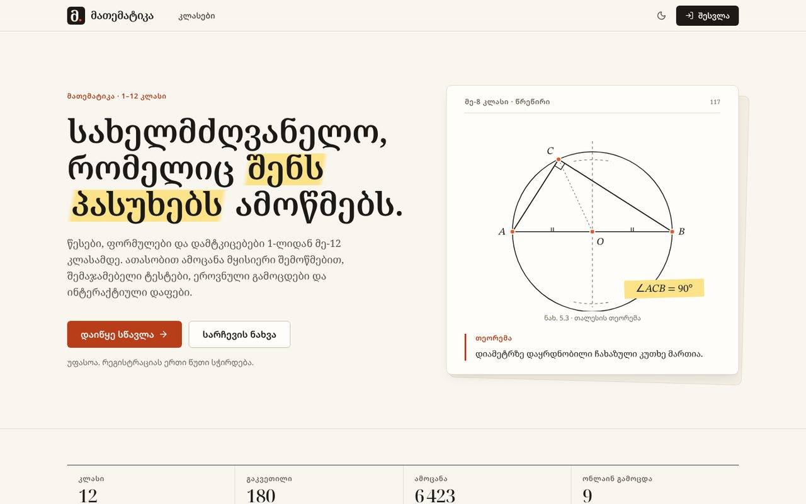
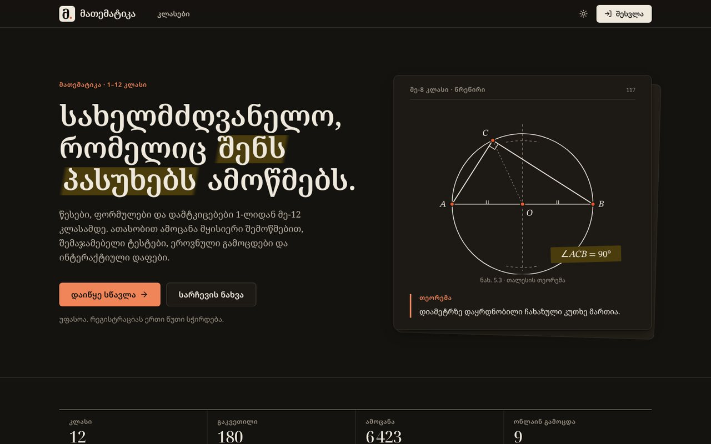
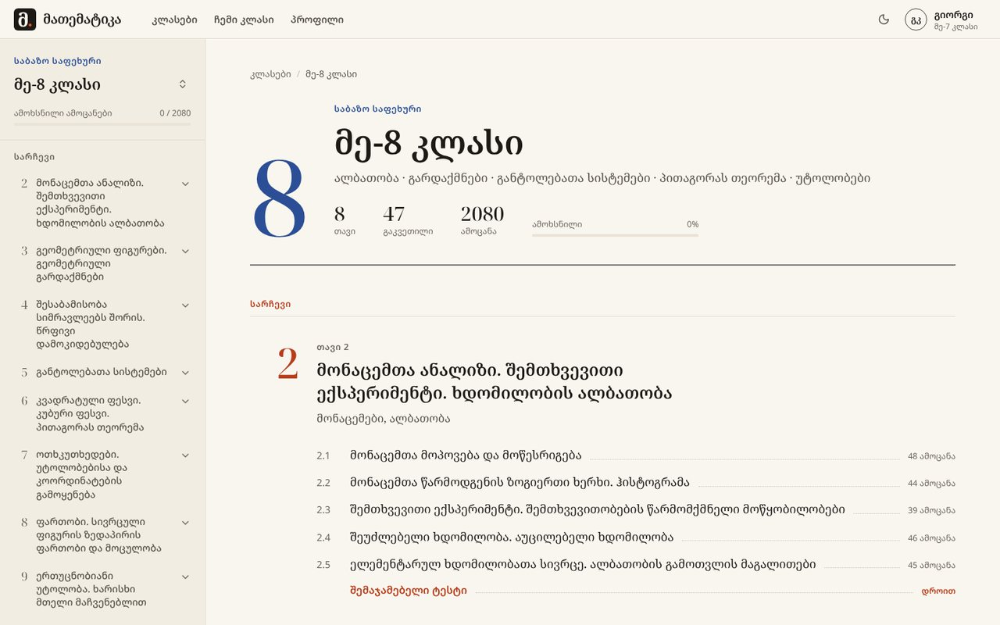
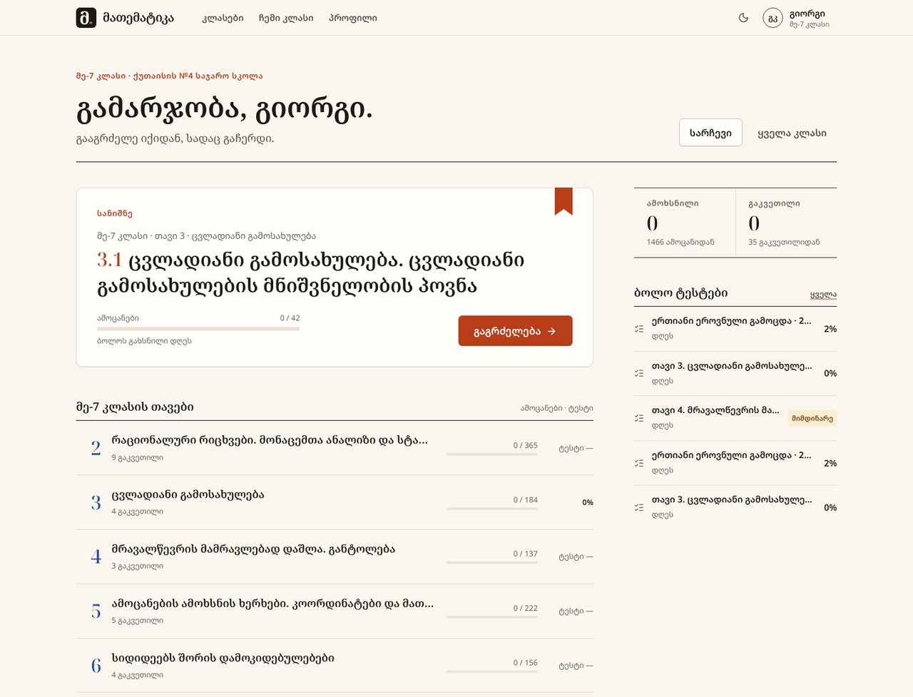
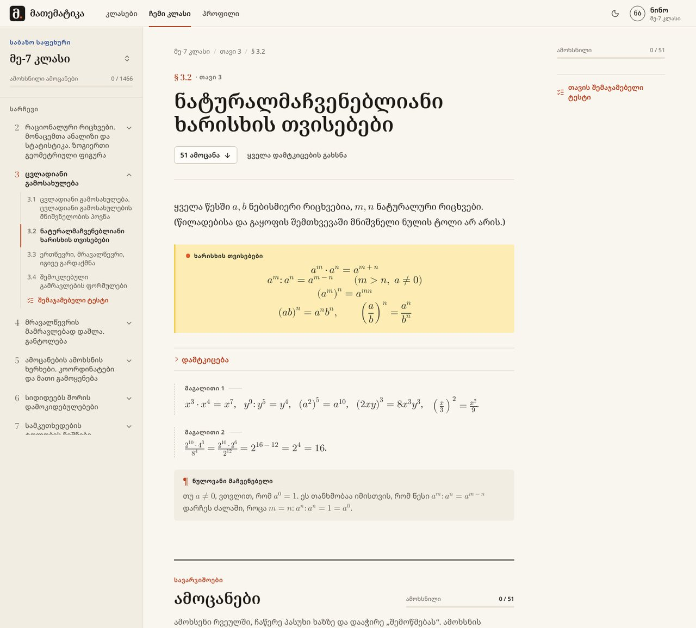
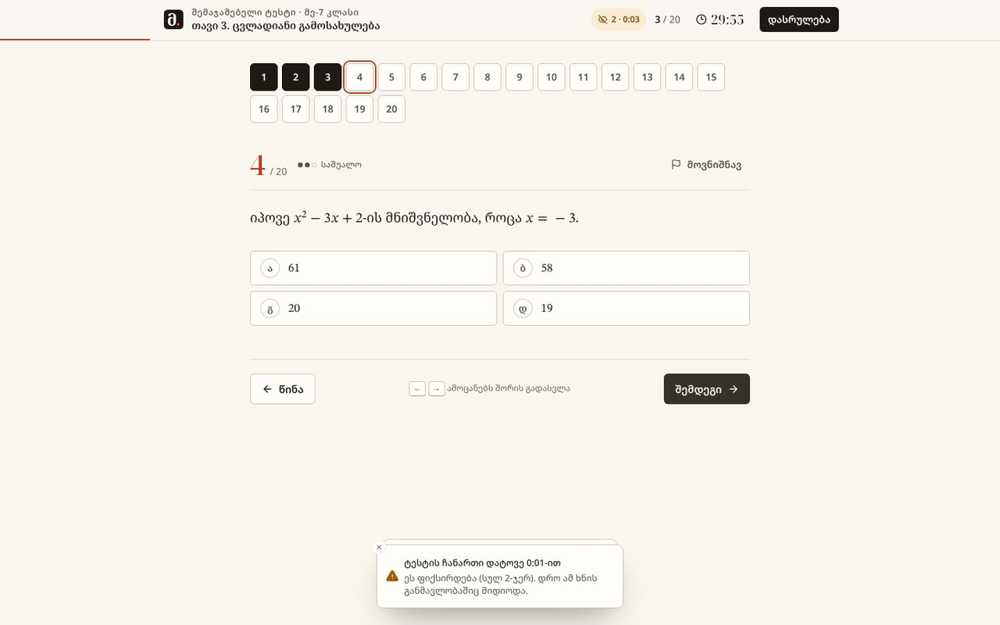
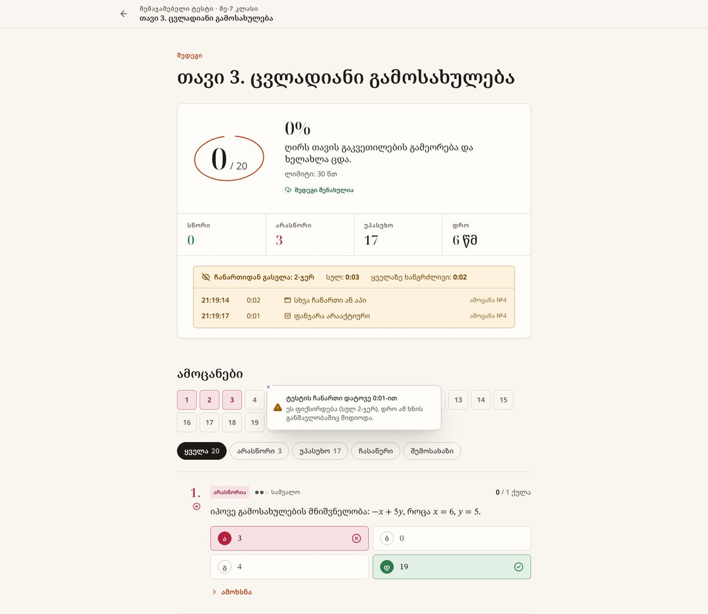
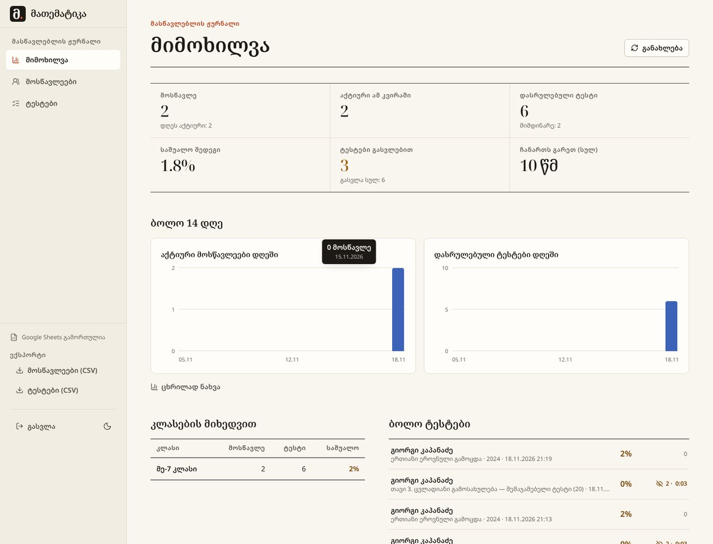
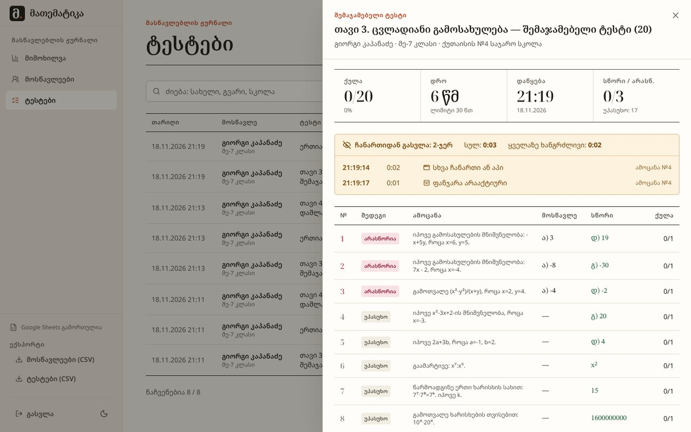
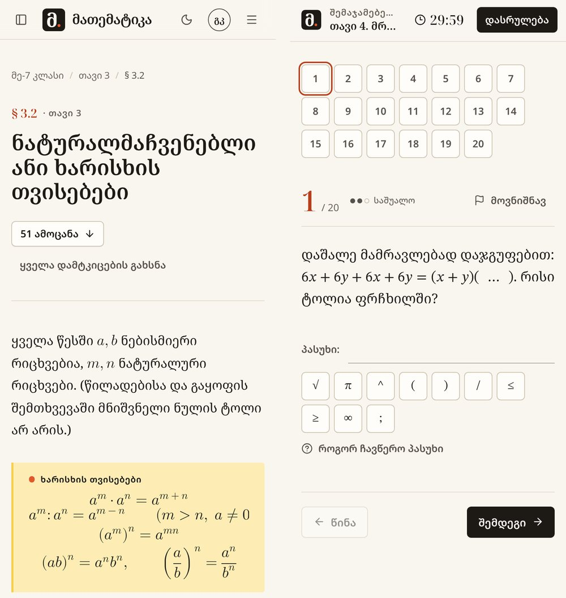

# მათემატიკა 1–12 — MERN learning platform

A full **MongoDB · Express · React · Node** rebuild of the single-file „მათემატიკა" app: lessons,
rules and proofs for grades 1–12, thousands of auto-checked problems, timed chapter tests, the grade 12
national exams, interactive boards — and a teacher dashboard. Every student and every test is saved
to **MongoDB** and mirrored to **Google Sheets**, including **which answers were correct** and
**whether the student left the test tab, how often and for how long**.

The interface is designed as a modern printed textbook — paper and ink, one vermilion spot colour, a
yellow highlighter for key formulas, serif Georgian headings, thin rules instead of boxes.

| | |
|---|---|
|  |  |
|  |  |
|  |  |
|  |  |
|  |  |

---

## Quick start (no database needed)

```bash
npm install
npm run demo          # builds the React app and starts the API with an in-memory store
```

Open **http://localhost:4000**. Teacher dashboard: **/teacher**, key `demo-teacher`.
Demo mode keeps data in memory only — use MongoDB for anything real.

## Development with MongoDB

Requirements: **Node.js ≥ 20.12** and **MongoDB** 6.0 or newer (local, Docker, or a free MongoDB Atlas cluster).

```bash
npm install
cp server/.env.example server/.env     # set MONGODB_URI, JWT_SECRET, TEACHER_KEY
npm run dev                            # API on :4000 + Vite on :5173 (proxies /api)
```

Open **http://localhost:5173**.

| Script (root) | What it does |
|---|---|
| `npm run dev` | API (watch mode) + Vite dev server |
| `npm run dev:demo` | same, but the API uses the in-memory store |
| `npm run build` | production build of the React app → `client/dist` |
| `npm start` | production server: API + the built app on one port |
| `npm test` | server tests (API, Sheets, Apps Script, schemas) + client tests (curriculum, scoring, tab tracking) |
| `npm run extract-content -- path/to/index.html` | re-extract the curriculum from the original single-file app |

## Production

```bash
npm install
npm run build
NODE_ENV=production npm start
```

The Express server serves the API under `/api` and the built React app for every other path.
Set at least `MONGODB_URI`, `JWT_SECRET` (long random string) and `TEACHER_KEY`. Behind a proxy
(Render, Railway, Nginx) also set `TRUST_PROXY=1` and serve over HTTPS. Run **one** server instance
when Google Sheets sync is on (the sync loop is per process).

---

## What is saved, and where

**MongoDB is the source of truth; Google Sheets is a live mirror.** Every record carries a sync flag,
so a Google outage only delays the sheet — nothing is lost and rows are updated in place, never duplicated.

| Data | MongoDB | Google Sheets tab |
|---|---|---|
| Student: name, grade, school, registration date, visits, active days, time on site, practice progress summary | `students` | **მოსწავლეები** |
| Practice problems (per problem: tries, solved, first-try, solution viewed) | `progresses` | — (summary in the student row) |
| Test attempts: test, start/finish, time used, score, %, counts, auto-submitted, **tab leaves** | `attempts` | **ტესტები** |
| Every answer of every test: question, student's answer, correct answer, result, points | `attempts.answers[]` | **პასუხები** (one row per question) |

### Sheet columns

**მოსწავლეები** (students): ID · სახელი (first name) · გვარი (last name) · კლასი (grade) · სკოლა (school) ·
რეგისტრაცია (registered) · ბოლო აქტივობა (last active) · ვიზიტები (visits) · აქტიური დღეები (active days) ·
დრო საიტზე (წთ) (minutes on site) · ამოხსნილი ამოცანები (problems solved) · პირველივე ცდით (first try) ·
ცდები სულ (tries) · დასრულებული გაკვეთილები (lessons completed) · დასრულებული ტესტები (tests) ·
საუკეთესო % (best) · საშუალო % (average) · ჩანართიდან გასვლები (ტესტებში) (tab leaves during tests) · ჩანართს გარეთ (წთ) (minutes away).

**ტესტები** (tests): ID · სტატუსი (მიმდინარე / დასრულებული — in progress / finished) · დაწყება (start) · დასრულება (finish) ·
მოსწავლის ID · მოსწავლე · კლასი · სკოლა · ტიპი (chapter test / exam) · ტესტი · ამოცანები (questions) · ქულა (score) ·
მაქს. ქულა · % · სწორი (correct) · არასწორი (wrong) · უპასუხო (unanswered) · ნაწილობრივ (partial) · შესაფასებელი (awaiting self-assessment) ·
დახარჯული დრო (time used) · დროის ლიმიტი (limit) · დრო ამოიწურა (auto-submitted) · **ჩანართიდან გასვლები** (how many times the tab was left) ·
**ჩანართს გარეთ (სულ)** (total time away) · **ყველაზე ხანგრძლივი გასვლა** (longest) ·
**გასვლების დეტალები** (each leave: clock time · duration · question № · type) ·
სწორი / არასწორი / უპასუხო ამოცანები (question numbers in each group).

**პასუხები** (answers): გასაღები (key) · ტესტის ID · დასრულება · მოსწავლე · კლასი · ტესტი · № · ტიპი (choice / written) ·
ამოცანა (the question, maths as readable text: x², √, (a+b)/(2b)…) · მოსწავლის პასუხი (student's answer) ·
სწორი პასუხი (correct answer) · შედეგი (correct / wrong / unanswered / partial / awaiting self-assessment) · ქულა · მაქს. ქულა.

A test appears in the sheet as soon as it starts (status „მიმდინარე") and is updated when the student
leaves the tab and when they finish — so abandoned tests and their tab leaves are visible too.

---

## Google Sheets — choose one option

### Option A · Apps Script web app (simplest, no Google Cloud project)

1. Create a Google Sheet → **Extensions → Apps Script**, replace the code with
   [`google-apps-script/Code.gs`](google-apps-script/Code.gs).
2. In `Code.gs` set `SECRET` to a long random value.
3. **Deploy → New deployment → Web app** — *Execute as:* Me, *Who has access:* Anyone → **Deploy**,
   authorize, copy the URL ending in `/exec`.
4. In `server/.env`:
   ```env
   SHEETS_MODE=apps-script
   SHEETS_WEBHOOK_URL=https://script.google.com/macros/s/…/exec
   SHEETS_WEBHOOK_SECRET=<the same value as SECRET>
   ```
5. Restart the server. The three tabs and their header rows are created automatically.

After editing `Code.gs`, publish a new version: **Deploy → Manage deployments → Edit → New version**.
(This replaces the original app's `teacher_backend.gs`; the payload format is new.)

### Option B · Service account (Sheets API)

1. In Google Cloud Console create a project, enable the **Google Sheets API**.
2. **IAM → Service accounts → Create**, then **Keys → Add key → JSON**.
3. Share your spreadsheet with the service account's e-mail as **Editor**.
4. In `server/.env`:
   ```env
   SHEETS_MODE=service-account
   GOOGLE_SHEET_ID=<the id in the spreadsheet URL>
   GOOGLE_SERVICE_ACCOUNT_EMAIL=<client_email from the JSON>
   GOOGLE_PRIVATE_KEY="<private_key from the JSON, with \n line breaks>"
   ```

Pending rows are pushed every `SHEETS_SYNC_INTERVAL_SEC` (default 60 s); finished tests go out right away.
The teacher dashboard shows the sync status and has a **„ხელახლა"** (resync everything) button.

---

## Tab-leave tracking

While a test (chapter test or exam) runs, the browser records every time the student leaves it:

| Type | When |
|---|---|
| **სხვა ჩანართი ან აპი** (`hidden`) | switched tab, minimised the browser, switched app on a phone |
| **ფანჯარა არააქტიური** (`blur`) | the page stayed visible but another window was in front |
| **გვერდი დახურული** (`closed`) | the page was closed or reloaded, or the device slept, while the timer kept running |

For each leave: start time, duration, and the question the student was on. Totals: count, total
time away, longest leave. Flickers under 0.4 s are ignored. The record lives inside the running test
in the browser, so it survives reloads; when a closed test is reopened, the time it was closed is
counted. The student is told up front that leaving is recorded, sees a counter in the timer bar and a
notice when they come back, and sees the full list on the result screen. The teacher sees it per test
(dashboard and sheet). Limitations: a browser can't see a second device, and `blur` also fires when the
student clicks the browser's own address bar or a system dialog.

Implementation: `client/src/features/tests/presence.js` (with tests in `client/test/presence.test.js`).

---

## Content

* **Original material** (grades 7, 8 and 11, grade 12 national exams 2023–2026 and practice tests, the four
  boards) is extracted from the original single-file app into `client/src/content/pack/` by
  `tools/extract-content.mjs`. The answer checker, problem generators, LaTeX→MathML renderer and SVG
  figures are kept as they were, so lessons, problems and exams behave as in the original.
* **General placeholder material** fills everything that was empty („მალე") — grades 1–6, 9 and 10, lessons for
  grade 12 (which only had exams) and grade 11 chapter VI: 28 chapters, 58 short lessons (definition, key
  formula, worked example) and 1,108 generated, auto-checked problems, so chapter tests work there too. It lives in
  `client/src/content/placeholders/`, is labelled **„ნიმუში"** in the UI, and is meant to be replaced:
  edit the lessons in place, or add real chapters and delete the placeholder ones.

* **Grade 11, chapter I (trigonometry)** has its own generators in `client/src/content/pack/trig11.js`
  (the old ones were removed from `core.js`). Every number answer there is **exact** — a fraction, a root or
  a multiple of π (`√3/2`, `(√6+√2)/4`, `2π/3`); the checker rejects decimals and function calls such as
  `sin(60)` for these keys (`exact: true`), and the practice card and the test input say so. Besides
  computing values, about a third of the chapter is simplification and identities: choose the simplified
  form, find the constant k that makes an identity true, decide whether an identity holds, simplify and
  evaluate. The **triple-angle formulas (3α) and the sine/cosine theorems (lesson 1.13) are practice only**:
  such problems carry `nt: 1` and are never drawn into the chapter test. Every identity in the banks is
  checked numerically by `client/test/content.test.js`.

Totals: 12 grades · 180 lessons · 6,933 problems · 9 online exams.

---

## Architecture

```
matematika/
├─ client/                     React 19 + Vite 8 + Tailwind CSS 4 + Radix UI + React Router 7
│  ├─ src/pages/               Home (cover / student desk), Grades, Grade, Chapter, Lesson, Tool,
│  │                           ChapterTest, Exam, Profile, Teacher, 404
│  ├─ src/features/
│  │  ├─ book/                 contents sidebar, grade index, lesson progress, "continue where you left off"
│  │  ├─ student/              session (sign-in), progress (local-first + sync), activity heartbeat, registration
│  │  ├─ tests/                presence (tab leaves), outbox (offline-safe saves), exam-room shell and test UI
│  │  └─ problems/             exercise card, symbol bar, answer help
│  ├─ src/content/             curriculum assembly, test logic, placeholders, extracted content pack
│  ├─ src/components/          ui primitives (shadcn-style), layouts, brand mark and figures, charts, math
│  ├─ src/assets/fonts/        STIX Two Math (trimmed, MATH table kept) + its OFL licence
│  └─ src/styles/              tokens.css (generated), Tailwind theme mapping, printed-page lesson styles
├─ server/                     Express 5 + Mongoose 9
│  ├─ src/models/              Student, Progress, Attempt
│  ├─ src/data/                mongo.js (default) and memory.js (demo/tests) — same interface
│  ├─ src/services/            students, attempts (scoring, tab-leave normalisation), teacher, sheets/
│  └─ src/routes/              /api/session, /api/me/*, /api/teacher/*
├─ google-apps-script/Code.gs  Sheets bridge for Option A
├─ docs/                       brand guidelines, design tokens, screenshots
└─ tools/extract-content.mjs   original index.html → content pack
```

**Four layouts.** *Front matter* (cover, grades, profile): header, centred page, colophon. *The book*
(grade, chapter, lesson, boards): the grade's table of contents on the left — a sheet on phones — and the
page on the right. *The exam room* (chapter tests, exams): no site navigation, just the test's name,
the clock, answered count and tab leaves. *The register* (teacher): its own sidebar with sections,
Sheets status and CSV export.

**Saving is offline-safe.** Practice progress is stored in the browser first and synced every few
seconds (merged on the server with `$max`, so two devices never overwrite each other). Test saves go
through an outbox that retries until the server confirms; each attempt has a browser-generated id, so
every save is an idempotent upsert.

### API

| Method & path | Purpose |
|---|---|
| `POST /api/session` | register or sign in (first name, last name, school, grade) → token |
| `GET/PATCH /api/me` | profile |
| `POST /api/me/activity` | active seconds + visit heartbeat |
| `GET/PUT /api/me/progress` | practice progress (merge) |
| `GET /api/me/attempts`, `GET /api/me/attempts/:clientId` | the student's tests |
| `PUT /api/me/attempts/:clientId` | start / progress ping / submit (idempotent) |
| `PATCH /api/me/attempts/:clientId/self-score` | points for open exam answers |
| `POST /api/teacher/session` | teacher key → token |
| `GET /api/teacher/overview` | KPIs, 14-day activity, by grade, recent tests, Sheets status |
| `GET /api/teacher/students[/:id]`, `GET /api/teacher/attempts[/:id]` | tables and details |
| `GET /api/teacher/export/students.csv`, `…/attempts.csv` | CSV (UTF-8 with BOM for Excel) |
| `GET /api/teacher/sheets`, `POST /api/teacher/sheets/resync` | Sheets sync status; push everything to the sheet again |
| `GET /api/health` | health check (database driver, Sheets mode) |

---

## Design system

Built with the ui-ux-pro-max, ui-styling, design-system and brand skills, direction „Textbook & editorial":

* **Brand** — [`docs/brand-guidelines.md`](docs/brand-guidelines.md): the „მ." monogram (Noto Serif Georgian
  **მ** with a vermilion full stop, outlined so it renders without fonts; `docs/brand/`), paper and ink with
  one vermilion spot colour, a highlighter for key formulas, stage “volumes” (ochre 1–6, cobalt 7–9,
  plum 10–12), voice and tone in Georgian.
* **Tokens** — [`docs/design-tokens.json`](docs/design-tokens.json), three layers (primitive → semantic →
  component, with a dark set), generated into `client/src/styles/tokens.css` and mapped to Tailwind
  utilities (`bg-surface`, `text-accent`, `font-serif`, `shadow-md` …). Every text/background pair meets
  WCAG AA in both themes (most AAA); the chart colour is validated for both surfaces.
* **Type** — Noto Serif Georgian for headings and reading text, Noto Sans Georgian for the interface,
  Noto Serif Display for large numerals, STIX Two Math for formulas. All fonts are **self-hosted**
  (Fontsource packages + a trimmed STIX Two Math), so the site makes no requests to Google and the CSP
  allows no third-party origins.
* **The printed page** — lessons are set like a book: § section marks, definitions on a vermilion rule,
  examples under a dashed rule, notes on sunken paper, key formulas on a highlighter, proofs that unfold
  and end with ∎, tables with heavy/light rules, exercises with hanging numbers and an answer line.
* **Accessibility** — checked with axe-core on every page in both themes (no serious issues); keyboard
  navigation, visible focus, labelled landmarks and controls, status never shown by colour alone,
  `prefers-reduced-motion` respected, 44 px touch targets, skip link, no horizontal scrolling at 390 px.

---

## Security and privacy notes

* Students sign in with first name, last name, grade and school — **no password**, exactly like the
  original app (the same details reopen the same profile on any device). Anyone who knows those details
  can open that profile; add a PIN to `detailsInput`/`studentKey` if your school needs more.
* The teacher dashboard is protected by `TEACHER_KEY` (constant-time compare, rate-limited) and issues
  12-hour tokens kept in `sessionStorage`.
* Helmet with a strict Content-Security-Policy (scripts, styles and fonts from the site itself only),
  JSON body limit, rate limits on sign-in endpoints, formula-injection protection for Sheets and CSV.

## Testing

```bash
npm test
```

* **server** (21): sign-in and identity, activity, progress merging, attempt lifecycle with tab leaves and
  per-question results, self-scoring, teacher endpoints and CSV, Sheets sync (batching, retries, upserts),
  `Code.gs` executed against a simulated spreadsheet, end-to-end server → Apps Script over HTTP, Mongoose
  schema validation.
* **client** (24): every grade has material; the cover's grade metadata matches the curriculum; every
  placeholder lesson renders; every generated problem accepts its own correct answer; chapter-test building
  and scoring; all 9 exams score correctly; tab-leave tracking across hidden tabs, unfocused windows,
  closed pages and reloads; TeX→text.
